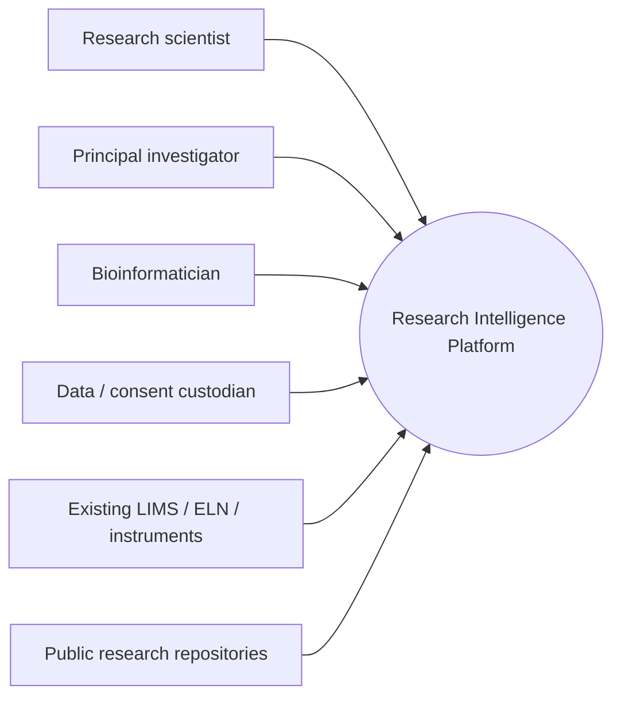
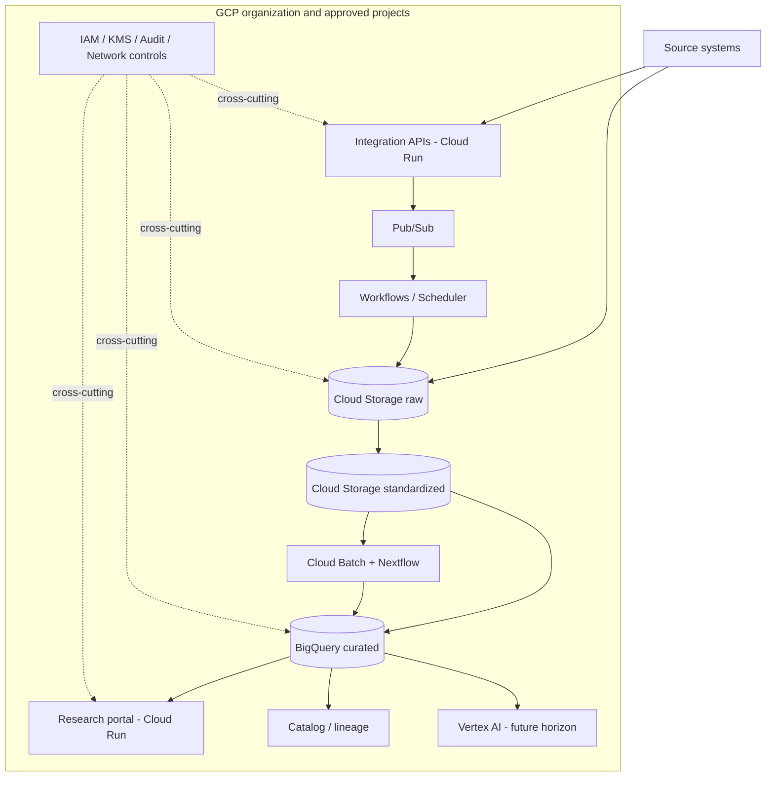
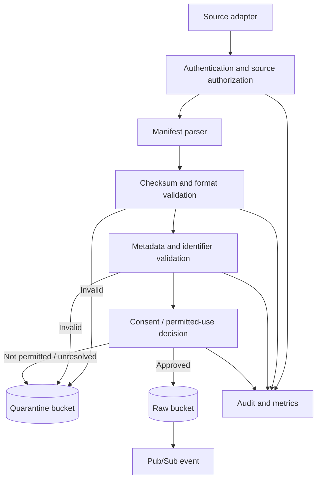

# C4 Architecture Views

These are logical views for architecture review. They are not deployment diagrams or evidence of deployed resources.

## C1 — System context



## C2 — Container view



## C3 — Component view: ingestion service



## C4 — Code-level design direction

The ingestion service should be decomposed into independently testable modules:
- Source connector interface.
- Authentication provider.
- Manifest and schema validator.
- File integrity verifier.
- Identifier resolver.
- Consent/purpose policy client.
- Storage promotion service.
- Event publisher.
- Audit and telemetry adapter.

Use contract tests for source connectors and integration tests against non-production GCP projects. Store secrets in Secret Manager and use workload identities rather than long-lived service account keys.

## Sequence — file ingestion

```mermaid
sequenceDiagram
  participant Lab as Lab instrument
  participant Gateway as Secure transfer gateway
  participant GCS as Cloud Storage quarantine
  participant Event as Pub/Sub
  participant Worker as Ingestion worker
  participant Policy as Research policy service
  participant Raw as Cloud Storage raw
  participant BQ as BigQuery metadata
  Lab->>Gateway: Export artifact + manifest
  Gateway->>GCS: Upload object
  GCS->>Event: Object finalized event
  Event->>Worker: Trigger processing
  Worker->>Worker: Checksum, format, schema and metadata validation
  Worker->>Policy: Evaluate purpose and data access eligibility
  Policy-->>Worker: Decision + policy reference
  alt Approved
    Worker->>Raw: Promote / register immutable source artifact
    Worker->>BQ: Write artifact and lineage metadata
  else Rejected or unresolved
    Worker->>GCS: Keep quarantined; record reason
  end
```
