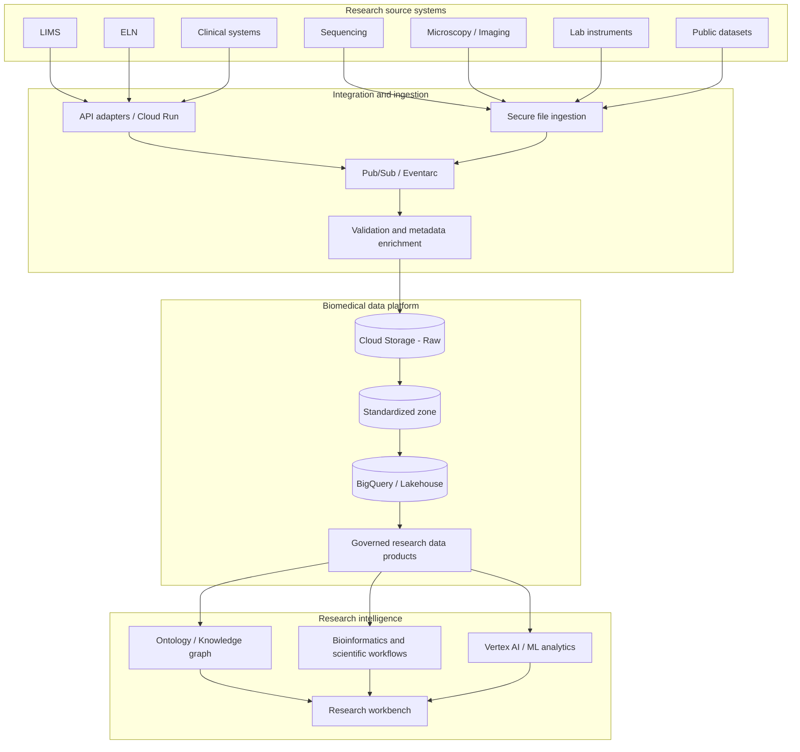

# Target-State Enterprise Architecture

## Logical layers

| Layer | Responsibilities | Candidate GCP services / technology |
|---|---|---|
| Research experience | Scientist workbench, disease workspaces, data explorer | Cloud Run, Identity-Aware Proxy where appropriate |
| Source integration | LIMS, ELN, instruments, sequencing, microscopy, clinical and public data | API adapters, secure file transfer, Pub/Sub |
| Ingestion and orchestration | Events, validation, scheduling, routing | Cloud Run, Pub/Sub, Eventarc, Workflows, Cloud Scheduler |
| Processing | Batch, stream, transformations and scientific workflows | Dataflow, Dataproc Serverless, Cloud Batch, Nextflow |
| Artifact storage | Raw and derived large scientific files | Cloud Storage |
| Analytical platform | Structured and curated datasets | BigQuery, BigLake; evaluate Iceberg where interoperability requires it |
| Metadata and governance | Catalog, lineage, data quality, policy | Knowledge Catalog capabilities, Dataplex lineage capabilities where available, policy services |
| Scientific knowledge | Ontologies, graph relationships, evidence | RDF store or graph database selected after a proof of concept |
| AI and analytics | Omics, imaging, functional assay and multimodal models | Python, PyTorch, Vertex AI |
| Cross-cutting foundation | Identity, network, encryption, audit, observability, FinOps | IAM, VPC, Cloud KMS, Audit Logs, Cloud Monitoring |

Service names and product capabilities should be revalidated at implementation time. Select services based on region availability, supported integrations, data residency, contractual terms and cost.

## End-to-end logical flow

## Trust boundaries
1. Identity and direct identifiers: tightly restricted custodian-controlled environment.
2. Sensitive coded research: approved research access, purpose limitation and audit.
3. General research analytics: de-identified or otherwise approved datasets, with re-identification risk assessed.
4. Public/open data: license and attribution requirements still apply.
5. AI training and inference: separate eligibility checks for dataset purpose, consent, license and model use.

## Deployment patterns
- API integration services: Cloud Run, with private ingress/egress where required.
- Eventing: Pub/Sub topics and subscriptions partitioned by domain and environment.
- File ingestion: controlled transfer into quarantine, followed by validation and promotion.
- Large batch bioinformatics: Nextflow on Cloud Batch; use GKE only where scheduling, specialized runtime or long-lived service needs justify it.
- Analytics: BigQuery and Cloud Storage; avoid copying large binary artifacts into relational tables.

## Key design constraints
- Do not assume all LIMS/ELN vendors expose compatible APIs or CDC.
- Do not send identifiable clinical data to general analytics by default.
- Do not equate de-identification with anonymity, especially for genomic data.
- Do not treat a knowledge graph as the system of record for raw scientific files.
- Do not promote data until schema, integrity, metadata and permitted-use checks pass.
