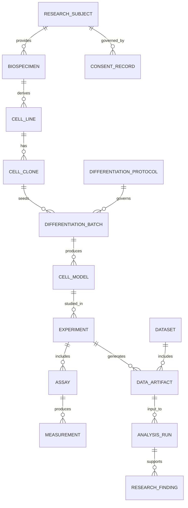

# Canonical Biomedical Research Model

## Modeling principles
- Use stable, opaque platform identifiers.
- Preserve source-system IDs and mappings.
- Support branching and many-to-many biological lineage.
- Separate entity identity from observations and events.
- Version protocols, schemas, datasets and analysis runs.
- Represent units and controlled terms explicitly.
- Keep direct identifiers outside general research analytics.
- Make provenance and consent references first-class relationships.

## Core entities

| Entity | Primary key | Important relationships |
|---|---|---|
| ResearchSubject | subject_id | Cohort, consent, biospecimen |
| Cohort | cohort_id | Research subject, study |
| ConsentRecord | consent_id | Subject, permitted purpose, version |
| Biospecimen | biospecimen_id | Subject, tissue, parent specimen |
| CellLine | cell_line_id | Biospecimen, parent line |
| CellClone | clone_id | Cell line, parent clone |
| Characterization | characterization_id | Cell line/clone, assay, result |
| DifferentiationProtocol | protocol_id + version | Cell model, batch |
| DifferentiationBatch | batch_id | Clone, protocol, conditions |
| CellModel | cell_model_id | Batch, cell type, disease context |
| Experiment | experiment_id | Model, protocol, study |
| Assay | assay_id | Experiment, assay definition |
| Measurement | measurement_id | Assay, sample/model, endpoint |
| DataArtifact | artifact_id | Source, experiment, assay, storage URI |
| AnalysisRun | analysis_run_id | Inputs, pipeline, parameters, outputs |
| ResearchFinding | finding_id | Analysis, evidence, reviewer |
| Dataset | dataset_id + version | Product, source artifacts, lineage |

## Relationship outline

The diagram is intentionally simplified. Production cardinalities must support pooled samples, split samples, multiple parent materials, replicate wells, repeated measurements, multiple assays per acquisition and derived artifacts.

## Identifier strategy
Use UUIDs or another opaque globally unique identifier for platform entities. Never encode donor identity, disease, site or other sensitive meaning in identifiers. Keep source-system keys in a source mapping table with source name, source key, entity type, validity interval and ingestion lineage.

## Measurement model
A measurement should include:
- measurement_id
- subject/sample/cell_model references as permitted
- experiment_id, assay_id, replicate_id
- endpoint_code and endpoint_label
- value_numeric or value_text
- unit_code and unit_system
- observed_at and recorded_at
- quality_status and quality flags
- instrument_id and instrument configuration reference
- protocol version
- source artifact reference

Do not force all assay outputs into one numeric field. Support categorical, ordinal, image-derived, time-series and structured results.

## Provenance
Each derived entity should be traceable to source artifact(s), transformation code/version, execution ID, parameters, actor/service identity and timestamp.

## Schema evolution
Use semantic versioning for data contracts. Additive optional fields can usually be backward-compatible; renames, type changes, altered meaning and changed enumerations require explicit migration and consumer coordination.
