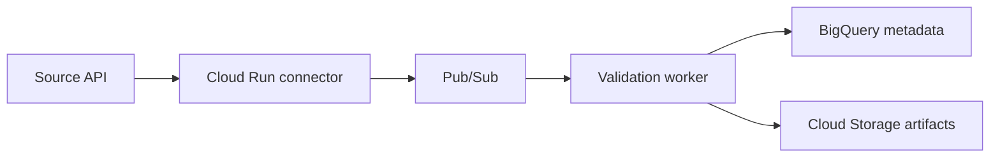

# Research Data Ingestion Patterns

## Source integration inventory

| Source | Preferred pattern | Fallback |
|---|---|---|
| LIMS | Vendor API, webhook or supported CDC | Scheduled export |
| ELN | Vendor API and document/attachment export | Controlled bulk export |
| Sequencing | Secure file transfer and manifest | Approved instrument staging gateway |
| Microscopy | Instrument export to managed landing zone | Secure batch transfer |
| Lab instruments | API, SDK or file export | Edge gateway and signed manifest |
| Clinical | FHIR, HL7v2 or approved DICOM integration | Governed export from source system |
| Public datasets | Repository API or bulk download | Manual reviewed import |

Do not assume source compatibility. For each source, document vendor, version, API limits, auth model, export formats, identifiers, update semantics, rate limits, network path and data owner.

## Pattern A — API integration

Use pagination, bounded retries, exponential backoff, source watermarks and idempotency keys. Capture source update timestamps and deletion/tombstone semantics.

## Pattern B — File-based ingestion

1. Source exports artifact and manifest.
2. Transfer gateway authenticates source and uploads to quarantine.
3. Object finalization event publishes a Pub/Sub message.
4. Worker validates checksum, format, size, schema and required metadata.
5. Identifier and consent/purpose checks execute.
6. Approved objects are promoted or registered in raw storage.
7. Metadata, lineage and audit records are written.
8. Invalid or unresolved objects remain quarantined with actionable error codes.

## Pattern C — Clinical integration
Use Cloud Healthcare API only for supported clinical interoperability patterns and only after confirming service eligibility, region, security, contractual and workflow requirements. Keep direct identifiers in a restricted trust zone. Produce a coded research representation only through an approved, documented process.

## Event contract
Every ingestion event should include:
- event_id and event_type
- source_system and source_record_id
- artifact_id and object URI where applicable
- schema_version
- occurred_at and ingested_at
- correlation_id
- classification
- processing_attempt
- manifest reference

Avoid sending direct identifiers or sensitive clinical payloads in Pub/Sub message bodies.

## Idempotency and retries
- Use deterministic idempotency keys based on source, source key/version and artifact checksum.
- Use dead-letter topics or an equivalent failure queue.
- Distinguish transient failures from permanent validation failures.
- Never retry a rejected consent or policy decision as though it were a network error.
- Maintain replay controls with authorization and audit.

## Validation gates
1. Authentication and source authorization.
2. Checksum and file integrity.
3. File type, schema and malware/security scanning as appropriate.
4. Required metadata completeness.
5. Controlled vocabulary and unit validation.
6. Identifier resolution and referential integrity.
7. Consent and permitted-use eligibility.
8. Quarantine or promotion decision.
9. Audit and lineage registration.

## Operational metrics
Track files received, accepted, quarantined, rejected, processing latency, retry count, missing metadata, duplicate rate, checksum mismatch, source freshness and cost per source/workflow.
